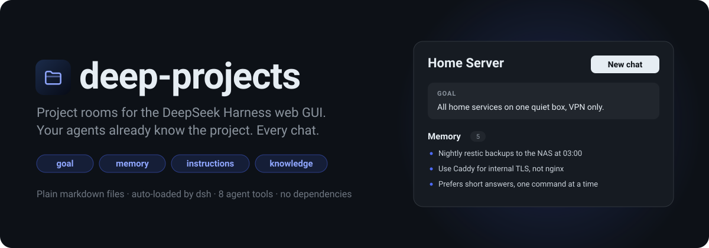
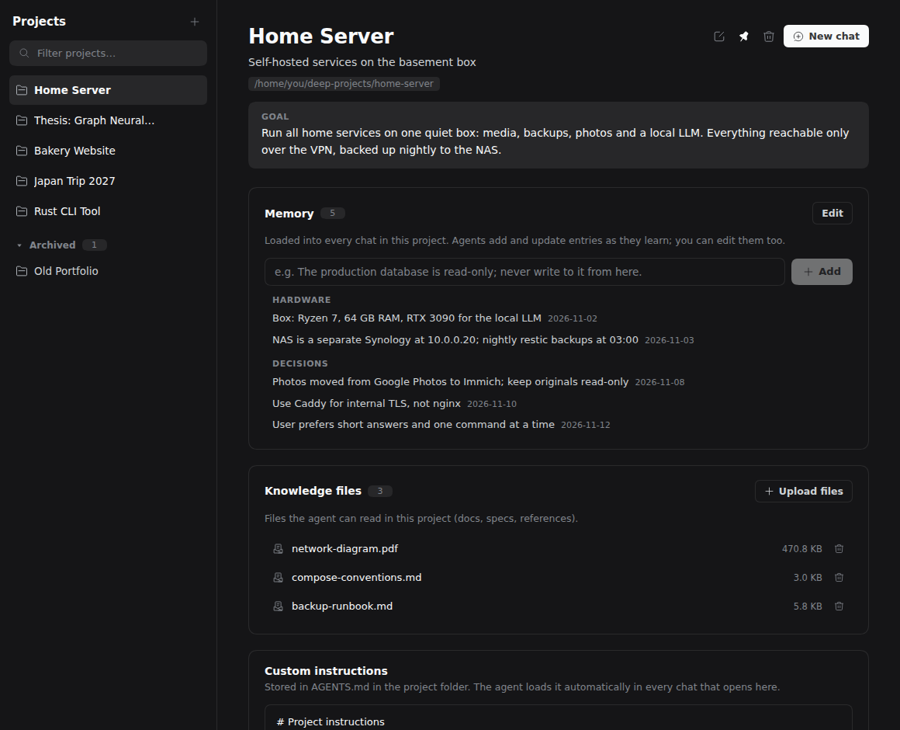
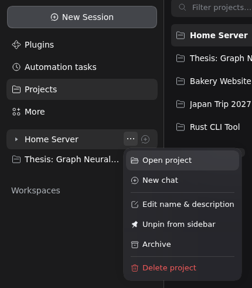

<p align="center">
  
</p>

<p align="center">
  <a href="https://www.npmjs.com/package/deep-projects"></a>
  <a href="https://www.npmjs.com/package/deep-projects"></a>
  
  <a href="https://github.com/JoblessJoe/deep-projects/blob/main/LICENSE"></a>
  <a href="https://joblessjoe.com/deep-projects"></a>
  <a href="https://github.com/topics/dsh-plugin"></a>
</p>

A [DeepSeek Harness](https://github.com/deepseek-ai/deepseek-harness) (dsh) web GUI plugin that gives every project **its own room**: a goal, custom instructions, knowledge files and a memory your agents keep up to date. Start a chat in the room and the agent already knows the project. You never explain it twice. Think Claude Desktop's Projects, built for dsh and your local models.

```bash
npx @deepseek-ai/dsh plugin --profile web add deep-projects
```

Then restart your dsh web server and reload the tab. **Projects** appears in the sidebar. Full details under [Install](#install).

<p align="center">
  
</p>

<p align="center">
  
  <br><sub>Pinned projects sit in the sidebar. The "…" menu opens, edits, pins, archives or deletes a project.</sub>
</p>

## What's in a room

- **Goal**: what the project is for and what done looks like. Every chat sees it.
- **Memory**: facts, decisions and preferences, one bullet each. You add and edit them; agents add new ones as they learn and fix stale ones. Every chat sees it.
- **Custom instructions**: the project's `AGENTS.md`, edited in place.
- **Knowledge files**: drag and drop docs, specs and references for the agent to read.
- **Chats**: every chat started from the project runs in its folder and is listed under it.

## Features

- **Projects page** with a filterable project list and one page per project.
- **Pinned projects in the sidebar**, styled like dsh's own rows. Click to open, or use the arrow to show the project's chats.
- **"…" menus** that match dsh's: open, new chat, edit, pin, archive, delete. Chat rows get dsh's usual chat menu.
- **Edit in place**: name, description and goal.
- **Archive**: hide finished projects without deleting anything. Restore any time.
- **One picker for projects and workspaces** on dsh's new chat screen, in place of its workspace chip. Projects get a goal icon, workspaces a folder.
- **Project tab** in the right sidebar of every chat that belongs to a project, plus a folder button in the chat header.
- **8 agent tools**, so agents can read and maintain projects themselves (see below).
- English and Chinese, light and dark theme, works on narrow screens. No runtime dependencies.

## How it works

Each project is a plain folder:

```text
~/deep-projects/<slug>/
  AGENTS.md         custom instructions
  AGENTS.local.md   goal + memory
  README.md         description
  knowledge/        your files
```

dsh already loads `AGENTS.md` and `AGENTS.local.md` from a chat's working folder. Chats started from a project run in that folder, so the goal, memory and instructions reach the model **natively, with no prompt injection**. Everything is plain markdown: read it, edit it by hand, or commit it to git.

- **Host**: JSON routes under `/api/deep-projects/` on the dsh web server, plus the agent tools. All file access stays inside the projects folder.
- **Client**: one self-contained bundle. It uses dsh's own design tokens, icons and context menus, so it looks native in both themes.

## Agent tools

| Tool | What it does |
| --- | --- |
| `projects_list` | List projects |
| `projects_create` | Create a project |
| `projects_read` | Read goal, instructions, memory and the knowledge list |
| `projects_update` | Change name, description, goal, instructions, pin or archive state |
| `projects_add_note` | Add one memory |
| `projects_set_memory` | Rewrite the memory list (fix, merge or remove entries) |
| `projects_add_knowledge` | Copy a file into the project's knowledge |
| `projects_delete` | Delete a project (its chats are kept) |

The memory file tells agents to keep it current, so they record new facts without being asked.

## Install

Into your dsh **web profile** (`web` below is the profile name; use whichever profile backs your web GUI). From a source checkout, use `pnpm dsh` instead of `npx @deepseek-ai/dsh`:

```bash
npx @deepseek-ai/dsh plugin --profile web add deep-projects
```

Restart the dsh web server afterwards (the plugin adds a new profile entry), then reload the browser tab.

Other sources:

```bash
# straight from GitHub
npx @deepseek-ai/dsh plugin --profile web add github:JoblessJoe/deep-projects
# from a local checkout
npx @deepseek-ai/dsh plugin --profile web add file:/path/to/deep-projects
```

**Projects folder**: `~/deep-projects` by default. Set `DSH_PROJECTS_ROOT` in the dsh server's environment to use another folder.

**Requirements**: the dsh web GUI, dsh 0.2.2 or newer (`engines.dsh`: `>=0.2.2-rc.1 <0.4.0-0`), Node 20+.

### No dsh patches needed

The plugin works on stock dsh. Three spots have no plugin seat, so it adjusts dsh's own UI from the plugin:

- **Sidebar tree**: mounted between the panel rows and the workspace list. If a dsh update changes the sidebar's layout, pinned projects fall back to plain sidebar rows that open the project.
- **Project chats use dsh's normal new chat screen.** dsh greys out its input for chats outside a workspace; the plugin lifts that for project chats.
- **Workspace chip**: replaced by the combined picker. Picking a workspace and "Add workspace…" still run dsh's own flow.

If a dsh update changes these internals, you get dsh's plain behavior back (plain sidebar rows, a greyed-out input in new project chats).

## Develop

```bash
npm install
npm run build              # lib/index.js (host) + lib/client.js (web)
node scripts/smoke.mjs     # routes + agent tools against a temp folder
DSH_REPO=/path/to/deepseek-harness node scripts/validate-tools.mjs   # dsh's real tool validator
```

## License

MIT
